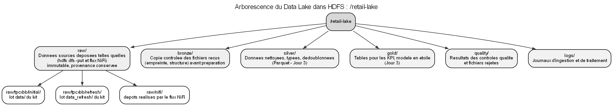

# UC-03 : Hadoop, HDFS et création du Data Lake

## 1. Environnement de travail

Les manipulations ont été faites dans une machine virtuelle VirtualBox (Ubuntu 16.04.7 LTS, 3 Go de RAM, 1 vCPU) sur mon poste Windows. Hadoop a été installé manuellement en mode pseudo-distribué : le NameNode, le DataNode et le SecondaryNameNode tournent sur la même machine, mais HDFS fonctionne réellement (blocs, métadonnées, démons séparés).

| Élément | Valeur |
|---|---|
| OS de la VM | Ubuntu 16.04.7 LTS (xenial), kernel 4.15 |
| Hadoop | 3.5.0, installé dans `/opt/hadoop` |
| Java pour Hadoop | OpenJDK Temurin 17.0.21 (`/opt/java/jdk-17.0.21+9`) |
| Java pour NiFi | OpenJDK Temurin 21.0.13 (`/opt/java/jdk-21.0.13+9`) |
| Mode HDFS | pseudo-distribué, 1 seul DataNode |
| Données HDFS | `~/hadoop-data/namenode` et `~/hadoop-data/datanode` |
| Utilisateur | `amani` |

Les paramètres principaux :

- `core-site.xml` : `fs.defaultFS = hdfs://localhost:9000`
- `hdfs-site.xml` : `dfs.replication = 1` (un seul DataNode, impossible de répliquer plus), `dfs.namenode.name.dir` et `dfs.datanode.data.dir` pointant vers `~/hadoop-data`.
- `hadoop-env.sh` : `JAVA_HOME` vers le JDK 17, heap réduit à 512 Mo (la VM n'a que 3 Go de RAM).

État des services après démarrage (`jps`) :

```
5008 NameNode
4378 SecondaryNameNode
5133 DataNode
6927 NiFi
```

Le rapport `hdfs dfsadmin -report` confirme un seul DataNode vivant (`127.0.0.1:9866`), 21,52 Go de capacité configurée et aucun bloc corrompu ou sous-répliqué. La sortie complète est dans `UC03_preuves/environnement/01_environnement.txt`.

## 2. Composants HDFS

- **NameNode** : le service qui gère l'espace de noms. Il sait quels fichiers et répertoires existent, comment chaque fichier est découpé en blocs et où sont ces blocs. Il ne stocke pas les données, seulement les métadonnées (fsimage + edits).
- **DataNode** : le service qui stocke réellement les blocs sur disque, les sert en lecture/écriture et envoie régulièrement un battement de cœur et la liste de ses blocs au NameNode.
- **SecondaryNameNode** : récupère périodiquement l'image du NameNode pour fusionner les edits (ce n'est pas un NameNode de secours).

**Mono-nœud ou distribué ?** L'environnement est mono-nœud (pseudo-distribué) : un seul DataNode, réplication à 1. C'est suffisant pour apprendre les commandes, mais il n'y a aucune tolérance de panne : si la VM tombe, tout est perdu.

## 3. Arborescence du Data Lake

J'ai créé l'arborescence `/retail-lake` demandée, avec les six zones :

```
/retail-lake
├── raw/          données sources déposées telles quelles
│   ├── tpcxbb/initial/   lot data/ du kit
│   ├── tpcxbb/refresh/   lot data_refresh/ du kit
│   └── nifi/             dépôts faits par le flux NiFi (UC-04)
├── bronze/       copie contrôlée (empreinte, structure) avant préparation
├── silver/       données nettoyées, typées, dédoublonnées (Jour 3)
├── gold/         tables des KPI, modèle en étoile (Jour 3)
├── quality/      résultats des contrôles qualité et fichiers rejetés
└── logs/         journaux d'ingestion et de traitement
```



La séparation en zones évite de mélanger des fichiers bruts non fiables avec des données validées, et permet de toujours revenir à la source. `raw/` est organisé par origine (`tpcxbb/initial`, `tpcxbb/refresh`) et par méthode de dépôt (`nifi/`), pour ne pas confondre le dépôt manuel de l'UC-03 avec le dépôt NiFi de l'UC-04.

Commandes exécutées et résultat (`hdfs dfs -ls -R /retail-lake`) :

```
drwxr-xr-x   - amani supergroup   0 2026-11-18 16:19 /retail-lake/bronze
drwxr-xr-x   - amani supergroup   0 2026-11-18 16:19 /retail-lake/bronze/tpcxbb
drwxr-xr-x   - amani supergroup   0 2026-11-18 16:19 /retail-lake/gold
drwxr-xr-x   - amani supergroup   0 2026-11-18 16:20 /retail-lake/logs
drwxr-xr-x   - amani supergroup   0 2026-11-18 16:20 /retail-lake/quality
drwxr-xr-x   - amani supergroup   0 2026-11-18 16:19 /retail-lake/raw
drwxr-xr-x   - amani supergroup   0 2026-11-18 16:19 /retail-lake/raw/nifi
drwxr-xr-x   - amani supergroup   0 2026-11-18 16:19 /retail-lake/raw/tpcxbb
drwxr-xr-x   - amani supergroup   0 2026-11-18 16:19 /retail-lake/raw/tpcxbb/initial
drwxr-xr-x   - amani supergroup   0 2026-11-18 16:19 /retail-lake/raw/tpcxbb/refresh
drwxr-xr-x   - amani supergroup   0 2026-11-18 16:19 /retail-lake/silver
```

## 4. Fichiers déposés

Trois fichiers réels du kit TPCx-BB ont été copiés dans la VM (par SFTP, empreinte SHA-256 vérifiée à l'arrivée, identique à celle du kit Windows). J'ai choisi trois fichiers de tailles différentes : deux pour le dépôt manuel, un petit pour le flux NiFi.

| Fichier | Chemin dans le kit | Format | Taille réelle | Contenu (schéma TPCx-BB) |
|---|---|---|---|---|
| `item.dat` | `data/item/item.dat` | texte, séparateur `\|`, sans en-tête | 6 799 286 o (6,5 Mo) | référentiel produits : `i_item_sk`, `i_item_id`, `i_rec_start_date`, `i_item_desc`, `i_current_price`, `i_wholesale_cost`, `i_brand_id`, `i_class`, `i_category`, `i_manufact`, `i_size`, `i_color`... 22 colonnes |
| `date_dim.dat` | `data/date_dim/date_dim.dat` | texte, séparateur `\|`, sans en-tête | 15 395 800 o (14,7 Mo) | dimension temps : `d_date_sk`, `d_date_id`, `d_date`, `d_year`, `d_moy`, `d_dow`, `d_week_seq`, `d_qoy`... 28 colonnes |
| `store.dat` | `data/store/store.dat` | texte, séparateur `\|`, sans en-tête | 3 386 o | dimension magasins : `s_store_sk`, `s_store_id`, `s_rec_start_date`, `s_number_employees`, `s_hours`, `s_store_manager`, `s_city`, `s_state`, `s_zip`, `s_country`... 29 colonnes |

Provenance : kit `retail_project` transmis par le formateur (Jour 1), lot `data/` (lot initial). Les empreintes et deux lignes d'aperçu de chaque fichier sont dans `UC03_preuves/data_lake/03_fichiers_locaux.txt`.

## 5. Dépôt manuel et vérifications

Dépôt de `item.dat` et `date_dim.dat` dans la zone raw (`store.dat` est réservé à NiFi) :

```
hdfs dfs -put /home/amani/retail_project/data/item/item.dat \
              /retail-lake/raw/tpcxbb/initial/
hdfs dfs -put /home/amani/retail_project/data/date_dim/date_dim.dat \
              /retail-lake/raw/tpcxbb/initial/
```

Résultat (`hdfs dfs -ls -h /retail-lake/raw/tpcxbb/initial/`) :

```
Found 2 items
-rw-r--r--   1 amani supergroup     14.7 M 2026-11-18 16:20 .../date_dim.dat
-rw-r--r--   1 amani supergroup      6.5 M 2026-11-18 16:20 .../item.dat
```

Vérifications faites ensuite :

- **Espace occupé** : `hdfs dfs -du -h /retail-lake` → 21,2 Mo dans `raw/`, les autres zones à 0 (elles seront remplies au Jour 3).
- **Permissions** : `-rw-r--r--`, propriétaire `amani`, groupe `supergroup`. J'avais d'abord tapé `hdfs dfs -ls -l` par réflexe (option Linux), qui n'existe pas — la bonne option est `-ls -h`. L'erreur et l'usage affiché sont conservés dans le fichier de preuve.
- **Lecture contrôlée** : `hdfs dfs -cat .../item.dat | head -3` affiche bien les premières lignes. Le message `cat: Unable to write to output stream` à la fin est normal : `head` ferme le tube avant la fin du fichier.
- **Récupération** : `hdfs dfs -get /retail-lake/raw/tpcxbb/initial/item.dat /tmp/item_depuis_hdfs.dat`.
- **Intégrité** : `sha256sum` sur le fichier récupéré et sur l'original local → empreintes identiques (`d8d48630...7fed21`). Le passage par HDFS n'a pas altéré le fichier.

## 6. Difficultés rencontrées

| Problème | Cause | Solution |
|---|---|---|
| NameNode et DataNode s'arrêtaient juste après le démarrage | les dossiers `~/hadoop-data` avaient été créés par `sudo`, donc appartenaient à `root` | `chown -R amani:amani ~/hadoop-data`, reformatage du NameNode, redémarrage |
| `ssh localhost` refusé au premier démarrage Hadoop | pas de clé SSH ni de serveur configuré | `ssh-keygen`, ajout de la clé publique dans `authorized_keys` |
| `java` et `jps` introuvables dans un shell | `JAVA_HOME` et `PATH` non exportés dans ce shell | export explicite des variables avant les commandes |
| `hdfs dfs -ls -l` rejeté | option `-l` qui n'existe pas dans la CLI Hadoop | `-ls -h` (tailles lisibles) |
| warning `Unable to load native-hadoop library` | bibliothèque native non compilée pour cette plateforme | warning sans impact, les commandes Java natives prennent le relais |
| VM lente (3 Go RAM, 1 vCPU) | resources limitées | heaps réduits (Hadoop 512 Mo, NiFi 512 Mo), démarrages patients |

## Questions de recul (UC-03)

**1. Quel est le rôle du NameNode dans HDFS ?**

Le NameNode gère l'espace de noms du système de fichiers : il sait quels fichiers et répertoires existent, comment chaque fichier est découpé en blocs et sur quels DataNodes ces blocs sont stockés. Il ne stocke pas les données, seulement les métadonnées (fsimage + edits). Sans lui, les blocs dans les DataNodes sont inexploitables.

**2. Quelle différence existe entre un NameNode et un DataNode ?**

Le NameNode est le « cerveau » : il gère les métadonnées et répond aux demandes de localisation. Les DataNodes sont les « bras » : ils stockent les blocs, les servent en lecture/écriture et envoient leurs battements de cœur au NameNode. Sur mon environnement mono-nœud, les deux tournent sur la même machine.

**3. Pourquoi HDFS découpe-t-il les fichiers en blocs ?**

Parce que les fichiers peuvent dépasser la capacité d'un disque. Le découpage en blocs (128 Mo par défaut) permet de répartir un gros fichier sur plusieurs machines, de lire et écrire en parallèle, et de ne retransférer qu'un bloc en cas de problème. Mes fichiers de 6,5 et 14,7 Mo tiennent chacun dans un seul bloc.

**4. Quel est l'intérêt de la réplication ?**

Chaque bloc est stocké plusieurs fois (3 par défaut) sur des DataNodes différents : si un nœud tombe, les données restent accessibles et HDFS recrée les répliques manquantes. Dans mon environnement la réplication est à 1 car il n'y a qu'un DataNode : la tolérance de panne n'existe pas.

**5. Pourquoi organiser un Data Lake en plusieurs zones ?**

Pour séparer les responsabilités : Raw conserve les données reçues, Bronze la copie contrôlée, Silver les données nettoyées et typées, Gold les tables prêtes pour les indicateurs. Chaque zone a des utilisateurs et des règles différents, et on évite de mélanger des données brutes non fiables avec des données validées.

**6. Pourquoi conserver les données sources dans Raw ?**

Parce que les traitements peuvent contenir des erreurs ou évoluer. Si on ne garde que le résultat transformé, on ne peut ni vérifier d'où vient un chiffre ni rejouer une préparation corrigée. Raw sert de référence : les fichiers y sont déposés sans modification, avec leur provenance.
