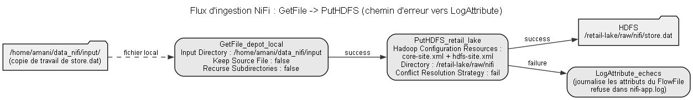

# UC-04 : Ingestion et orchestration avec Apache NiFi

## 1. Environnement NiFi

| Élément | Valeur |
|---|---|
| NiFi | 2.12.0, installé dans `/opt/nifi` |
| Java | OpenJDK Temurin 21.0.13 |
| Interface | HTTPS, `https://localhost:8443/nifi` (dans la VM) |
| Authentification | identifiants générés par NiFi au premier démarrage (conservés dans la VM uniquement) |
| Heap | 512 Mo (`bootstrap.conf`, adapté aux 3 Go de la VM) |
| Extensions ajoutées | `nifi-hadoop-nar-2.12.0.nar`, `nifi-hadoop-libraries-nar-2.12.0.nar` |

Point important : le paquet standard de NiFi 2.12.0 ne contient **pas** `PutHDFS`. J'ai dû télécharger les deux NAR Hadoop de la même version et les déposer dans `extensions/` : `PutHDFS` est apparu après le rechargement. C'est la difficulté principale de ce TP (détail en §6).

`nifi.sh status` retourne `Status: UP`, et `jps` montre le processus `NiFi` (preuve : `UC03_preuves/environnement/01_environnement.txt`).

## 2. Concepts NiFi utilisés

- **FlowFile** : l'unité qui circule dans le flux = le contenu du fichier + des attributs (nom, chemin source, taille, uuid, dates). C'est ce qui permet de tracer chaque fichier.
- **Processor** : un composant qui fait une action sur les FlowFiles (lire, écrire, journaliser...). Il a des propriétés et des **relations** de sortie.
- **Connection** : le lien entre deux processeurs, associé à une relation (`success`, `failure`). Elle transporte le FlowFile et fait file d'attente.
- **Provenance** : le journal des événements de chaque FlowFile (RECEIVE, SEND, DROP...) avec horodatage et attributs. C'est la preuve de ce qui s'est réellement passé.

## 3. Le flux construit



Trois processeurs, deux connexions :

| Processeur | Type | Propriétés principales |
|---|---|---|
| `GetFile_depot_local` | GetFile | Input Directory : `/home/amani/data_nifi/input` ; Keep Source File : `false` ; File Filter : `[^\.].*` |
| `PutHDFS_retail_lake` | PutHDFS | Hadoop Configuration Resources : `core-site.xml`, `hdfs-site.xml` ; Directory : `/retail-lake/raw/nifi` ; Conflict Resolution Strategy : `fail` |
| `LogAttribute_echecs` | LogAttribute | journalise les attributs du FlowFile dans `nifi-app.log` |

Connexions :

- `GetFile → (success) → PutHDFS`
- `PutHDFS → (failure) → LogAttribute_echecs`
- les autres relations de PutHDFS (`success` est consommée par l'écriture HDFS elle-même ; `retry`, `wait`...) : `success` et `failure` sont les deux relations exposées — `success` est auto-terminée après écriture, `failure` part vers LogAttribute.

Choix faits :

- **Destination séparée** `/retail-lake/raw/nifi` : le dépôt NiFi ne se confond pas avec le dépôt manuel de l'UC-03 (`raw/tpcxbb/initial/`). On peut comparer les deux provenances.
- **Conflict Resolution = `fail`** : si un fichier du même nom existe déjà, le FlowFile part en `failure` au lieu d'écraser — c'est le contrôle anti-doublon testé en §5.
- **Échec → LogAttribute** : un échec n'est jamais perdu silencieusement ; il est journalisé avec les attributs du FlowFile, visible dans les bulletins et la provenance.
- `Keep Source File = false` : le fichier source est consommé après lecture (comportement d'ingestion classique ; le kit original dans `retail_project/` n'est de toute façon pas touché, on travaille sur une copie dans `data_nifi/input/`).

Le flux a été créé par l'API REST de NiFi (script `scripts/04_creer_flux_nifi.py`), avec vérification de la validité de chaque processeur avant démarrage. La définition complète du flux est exportée dans `UC04_preuves/configuration/08_flow_nifi_export.json.gz` (fichier `flow.json.gz` de NiFi).

## 4. Exécution réelle

Une copie de `store.dat` (3 386 o) a été déposée dans le dossier d'entrée, puis les trois processeurs démarrés. Résultat :

```
PROC GetFile_depot_local   | state: RUNNING | out: 1 (3.31 KB)
PROC PutHDFS_retail_lake   | state: RUNNING
PROC LogAttribute_echecs   | state: RUNNING
CONN [success]             | 1 FlowFile transmis
```

Côté HDFS :

```
Found 1 items
-rw-r--r--   1 amani supergroup   3.3 K 2026-11-18 17:04 /retail-lake/raw/nifi/store.dat
```

Contrôle d'intégrité : `hdfs dfs -get` du fichier déposé, puis `sha256sum` comparé à l'original → empreintes identiques (`a936bc38...1808ef`).

Provenance (événement complet dans `UC04_preuves/provenance/provenance_run.json`) :

```
RECEIVE | 17:03:22 | GetFile_depot_local | file:/home/amani/data_nifi/input/store.dat
SEND    | 17:04:51 | PutHDFS_retail_lake | -> hdfs
ATTRIBUTES_MODIFIED | 17:04:51 | PutHDFS
DROP    | 17:04:51 | fin du FlowFile après success
```

On y voit le chemin source exact (`transitUri`), le nom, la taille (3 386 o) et l'uuid du FlowFile — la traçabilité complète du fichier.

## 5. Tests d'erreur contrôlés

**Test A — chemin source inexistant.** J'ai cassé la configuration de `GetFile` en pointant `Input Directory` vers `/home/amani/data_nifi/input_inexistant`, puis tenté de le relancer : le processeur refuse de démarrer (la propriété est invalide), il reste `STOPPED`. J'ai ensuite rétabli le bon chemin et le processeur est reparti `RUNNING`. Trace : `UC04_preuves/erreurs/uc04_erreur_test.txt`. C'est un échec de configuration, détecté par la validation NiFi avant tout traitement.

**Test B — doublon dans HDFS (échec d'exécution).** J'ai re-déposé le même `store.dat` dans le dossier d'entrée alors que `/retail-lake/raw/nifi/store.dat` existe déjà. Comme `Conflict Resolution = fail`, PutHDFS a refusé d'écraser :

```
BULLETIN: PutHDFS[...] penalizing FlowFile[filename=store.dat] and routing
          to failure because file with same name already exists
CONN ['failure'] | 1 FlowFile transmis vers LogAttribute_echecs
```

Le FlowFile a été routé en `failure`, journalisé par LogAttribute (extrait de `nifi-app.log` dans `UC04_preuves/erreurs/07_log_nifi_echec.txt`), et l'événement apparaît dans la provenance (`provenance_doublon.json`). Vérification après coup : toujours **un seul** `store.dat` dans `/retail-lake/raw/nifi/` — pas de doublon, pas d'écrasement.

C'est la distinction échec technique / rejet en pratique : ici le fichier a bien été lu (ce n'est pas un problème d'infrastructure), c'est la règle « ne pas écraser » qui l'a rejeté — et le flux l'a traité proprement au lieu de planter.

## 6. Difficultés rencontrées

| Problème | Cause | Solution |
|---|---|---|
| `PutHDFS` « not known to this NiFi instance » (HTTP 409 à la création) | le NAR Hadoop n'est pas inclus dans la distribution NiFi 2.12.0 | téléchargement de `nifi-hadoop-nar` + `nifi-hadoop-libraries-nar` en 2.12.0, dépôt dans `extensions/`, rechargement |
| Processeur `INVALID` à la création | relation `failure` non connectée / pas de connexion amont pour PutHDFS | connexion `success` GetFile→PutHDFS, puis `failure` PutHDFS→LogAttribute ; validation repassée `VALID` avant démarrage |
| Relation `success` de GetFile non traitée | NiFi exige que chaque relation soit connectée ou auto-terminée | connexion explicite vers PutHDFS |
| Démarrage NiFi très long | 1 vCPU, 3 Go de RAM | heap réduit à 512 Mo, attente du `Status: UP` avant d'utiliser l'API |
| Le token REST expire | durée de vie du token NiFi | régénération du token avant chaque session de scripts |

## Questions de recul (UC-04)

**7. Quel est le rôle d'un FlowFile dans NiFi ?**

C'est l'unité qui circule dans le flux : un contenu (ici `store.dat`) plus des attributs (nom, chemin, taille, uuid, dates). Les processeurs travaillent dessus et la provenance enregistre tout ce qui lui arrive — c'est ce qui permet de tracer un fichier de bout en bout.

**8. Quelle différence existe entre un Processor et une Connection ?**

Le Processor fait une action (GetFile lit un fichier local, PutHDFS écrit dans HDFS). La Connection est le lien entre deux processeurs : elle transporte le FlowFile et fait office de file d'attente quand le processeur en aval n'est pas prêt. Chaque connexion correspond à une relation (success, failure...).

**9. Pourquoi la provenance est-elle importante ?**

Elle répond à « d'où vient ce fichier, que lui est-il arrivé, quand ». En cas d'anomalie, on retrouve le FlowFile à l'origine, l'heure de lecture, le chemin source et le dépôt effectué — indispensable pour la confiance dans les données et pour le débogage. Dans mon test, elle montre exactement le RECEIVE de `store.dat` et son SEND vers HDFS.

**10. Comment distinguer un échec technique d'un rejet métier ?**

Un échec technique empêche le traitement de s'exécuter : service HDFS arrêté, permission refusée, chemin inexistant — l'infrastructure est en cause. Un rejet métier, c'est un fichier lu mais non conforme à une règle (mauvaise extension, structure de colonnes inattendue, nom déjà présent) : il doit être mis de côté avec le motif plutôt que faire échouer tout le flux.

**11. Quels risques apparaissent si un flux est relancé sans contrôle des doublons ?**

On dépose le même fichier plusieurs fois : fichiers dupliqués dans HDFS, données comptées deux fois dans les agrégats. Il faut une règle claire : `Conflict Resolution = fail` dans PutHDFS, et vérification de la destination avant relance — exactement ce que montre le test B.

**12. Quelles limites présente un environnement mono-nœud ?**

NameNode et DataNode sur la même machine : si elle tombe, tout est indisponible, et la réplication à 1 n'apporte aucune tolérance de panne. Pas de parallélisme entre machines non plus. Ça suffit pour apprendre, mais ce n'est pas un cluster de production.

**13. Pourquoi une copie locale ne constitue-t-elle pas une preuve de dépôt HDFS ?**

Copier un fichier d'un dossier local vers un autre ne passe par aucun mécanisme HDFS : pas de bloc, pas de métadonnées NameNode, pas de permissions HDFS. La preuve d'un dépôt, c'est une sortie `hdfs dfs -ls`, `-du` ou `-cat` sur le chemin HDFS, ou l'événement de provenance du flux.

**14. Quelles informations doivent être conservées pour reproduire une ingestion ?**

La source exacte (chemin, nom, taille, empreinte), la destination HDFS, la date/heure, l'outil et sa configuration (commande hdfs ou paramètres des processeurs), l'utilisateur, et le résultat des vérifications. Avec le journal d'ingestion et les événements de provenance, on peut refaire ou contrôler la même opération plus tard.
